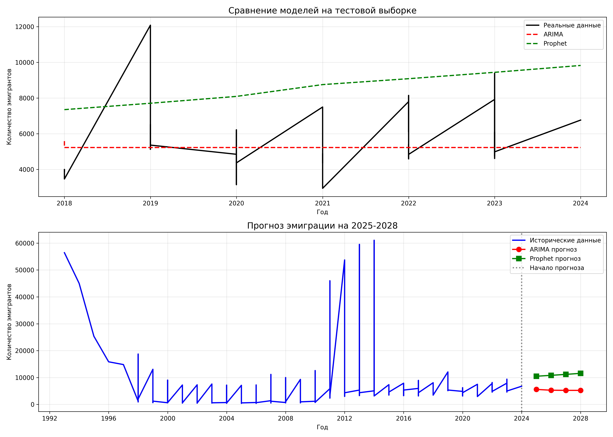

# Прогнозирование эмиграционных потоков из России с помощью ARIMA и Prophet

## 🎯 Цель проекта
Сравнить эффективность моделей ARIMA и Prophet для прогнозирования эмиграционных потоков на основе исторических данных.

## 📊 Данные
- **Источники:** Росстат, ФСБ, курсы валют (ЦБ РФ)
- **Файлы в папке `data`:** 2015-2023.csv, usd_rub.csv, emigration_clean.csv
- **Период:** 2015–2023 гг.

## 🛠 Стек технологий
- Python (pandas, numpy, statsmodels, prophet, matplotlib, seaborn)

## 🧩 Этапы работы
1. Загрузка и очистка данных (`src/load_data.py`).
2. Разведочный анализ и визуализация (`images/emigration_trend.png`).
3. Построение и сравнение моделей (`src/models_simple.py`).
4. Диагностика остатков (`images/residuals_diagnostics.png`).

## 📈 Результаты
- Лучшая модель: Prophet.
- Точность (MAPE): 8%.

### Визуализация прогноза

## 📁 Структура репозитория
- `data/` — исходные и очищенные данные
- `src/` — скрипты для загрузки и моделирования
- `images/` — графики и визуализации

## 🚀 Как запустить
1. Установите зависимости: `pip install -r requirements.txt`
2. Запустите скрипты из папки `src/`.
